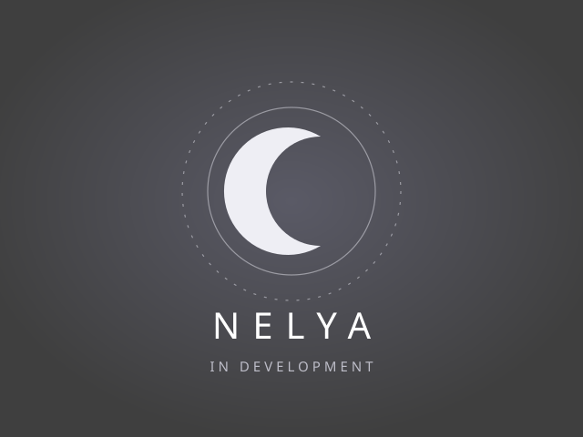
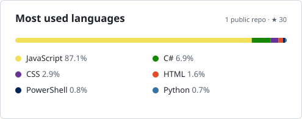

  

  

I build desktop companions for Windows: characters that live on top of your windows, react to music and to what you are doing, and keep the everyday stuff — apps, folders, music, VPN — one click away.

## 🛠 Projects

<table>
  <tr>
    <td width="50%" valign="top">
      
      <h3><a href="https://github.com/dark-anishi/capri-desktop-noir">Capri Desktop · NOIR</a></h3>
      

        
        
        
      

      A black-and-white desktop companion: Capri sits on window edges, dozes, reacts to music and Codex activity. App and folder launcher, Yandex Music, Mihomo VPN and Zapret controls in one place.
        
      <a href="https://github.com/dark-anishi/capri-desktop-noir/releases/latest"><b>Download</b></a> ·
      <a href="https://github.com/dark-anishi/capri-desktop-noir/blob/main/docs/SCREENSHOTS.md">Screenshots</a>
        
      An independent continuation of <a href="https://github.com/mochiiwuff/capri-desktop">Capri Desktop</a> by mochiiwuff.
    </td>
    <td width="50%" valign="top">
      
      <h3>Nelya</h3>
      

        
        
      

      A 3D desktop companion with custom VRM models — the next step after Capri.
      <ul>
        <li>Dances to music, synced to BPM and song sections</li>
        <li>Local fine-tuned voice and Whisper voice input with a wake word</li>
        <li>Visual command editor: say a phrase → run a chain of actions</li>
        <li>Chat, music player and a built-in VPN</li>
      </ul>
    </td>
  </tr>
</table>

## 🔭 Currently building

- **Nelya** — voice, lip-sync and gestures for a 3D companion that runs entirely on your PC.
- Making local speech synthesis fast enough to talk while the character is rendering.

## ⚙️ Stack

  

## 📊 Stats

  <picture>
    <source media="(prefers-color-scheme: dark)" srcset="assets/top-langs-dark.svg">
    
  </picture>
  <picture>
    <source media="(prefers-color-scheme: dark)" srcset="https://streak-stats.demolab.com?user=dark-anishi&theme=dark&hide_border=false&border=30363d&background=0d1117&ring=8b8b99&fire=c9d1d9&currStreakLabel=f0f6fc&date_format=M%20j%5B%2C%20Y%5D">
    
  </picture>

  

